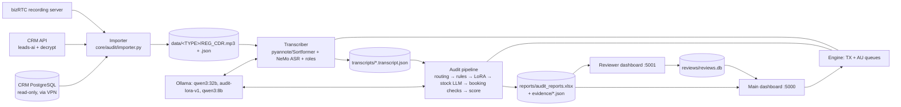

# Kataria AI Call Audit — Project Analysis Report

*Read-only investigation of the repository at commit `ff4c447` plus 4 uncommitted template edits (2026-10-27). Nothing was executed against models, the CRM database or external services. References are `file:line`.*

**Contents:** 1 Executive summary · 2 What it is · 3 Architecture · 4 Workflow · 5 Modules · 6 Technology · 7 Models · 8 Training · 9 Evaluation · 10 Outputs · 11 Status · 12 Security · 13 Risks · 14 Assessment

---

## 1. Executive Summary

**In plain words:** the system listens to recorded phone calls between a car dealership's customer-relationship executives (CREs) and customers, writes down what was said, and checks each call against a quality checklist (greeting, recording disclosure, booking details, politeness and so on). It gives every call a score out of 100, flags fake bookings and wrongly tagged calls, and shows the results on a web dashboard. Human reviewers can then agree or disagree with the AI on a separate dashboard.

| Item | Finding |
|---|---|
| Category | Speech analytics + LLM-based quality audit (internal tool) |
| Users | Dealership quality team (main dashboard); human reviewers (reviewer dashboard) |
| Input | Call recordings + CRM call/vehicle data (PostgreSQL replica, CRM REST API) |
| Stack | Python, Flask, NVIDIA NeMo ASR, pyannote, Ollama (Qwen3 stock + LoRA fine-tune), PostgreSQL (read-only), SQLite, openpyxl |
| Output | Weighted /100 score per call in `audit_reports.xlsx`, per-call evidence JSON, dashboards, Excel/zip exports, human reviews |
| Status | Core pipeline implemented end to end on one GPU host; no automated tests; model training not reproducible from the repo |

## 2. What Is This Project?

**Problem.** Manually auditing CRE calls is slow. The checklist and weights live in code (`core/audit/params.py:180`, `:317`); every call type has 18–21 parameters summing to 100 points. A planning document targets 40,000 calls/day (`GPU_SERVER_PLAN.md` §1, *goal, not verified*).

**Purpose.** Automate the audit for four call types: Booking, Follow-up, Service Not Required, Escalation (`core/audit/params.py:427`), and catch fake bookings and wrong call tagging.

**Users.** One operator runs the main dashboard (`api/app.py`). Reviewers use a separate, restricted dashboard (`reviewer/app.py:1-14`). CREs benefit indirectly through coaching tips.

**How it helps.** It pulls calls from the CRM, downloads recordings, transcribes them, scores them, and produces CRE performance tables, fake-booking lists and Excel exports (`api/app.py:682`, `:731`, `:752`).

**Scenario (illustrative).** The operator opens yesterday's calls, ticks "Booking" on the *Not audited* page and presses *Audit*. The system downloads the missing recordings, transcribes them, audits each one and writes the scores. A reviewer later disagrees with a "Zero" on *thank-you close* and adds a note; the main dashboard shows that review next to the AI score.

**Technical view.** A two-stage GPU pipeline (diarization + ASR → LLM audit) is fed by a persistent in-process queue (`workers/engine.py:54`, `:163`, `:365`). Call-type routing and the score arithmetic are deterministic Python; LLMs only produce per-parameter ratings and booking judgements. Results are persisted to Excel and JSON rather than a database.

## 3. Architecture

The main Flask app owns everything that changes state: CRM import, the engine, batches and exports. The reviewer app only reads audit artefacts and writes reviews to its own SQLite file (`core/reviews.py`). All inference is local (Ollama on `localhost:11434`; NeMo/pyannote on the GPU). External services are the CRM database (`core/db.py`), the CRM REST API (`core/crm_api.py:7-10`), the bizRTC recording host (`core/recordings.py:4`) and a Hugging Face token for pyannote. Deployment evidence points to one DGX machine on a LAN (`GPU_SERVER_PLAN.md`, a planning document).

## 4. End-to-End Workflow

1. **Trigger.** The operator picks calls (`/api/day`, `api/app.py:1125`) and starts a run (`/api/db/run`, `:1026`) or a batch (`/api/batch`); a CLI also exists (`core/audit/importer.py`, `core/audit/pipeline.py:1910`). Already-downloaded calls are skipped; known failures are excluded from *Not audited*.
2. **Import.** `crm_db` lists connected (bizRTC `ANSWERED`) calls of the configured lead type (`config.py:87`, default `UNNATI`). Each recording is decrypted through the CRM API and downloaded from bizRTC (`core/recordings.py:132`), then saved with a JSON sidecar of CRM data (`core/audit/importer.py:143-145`).
3. **Transcription** (`core/transcriber.py:937` `process_file`). pyannote `speaker-diarization-community-1` (`:553`), or a fine-tuned Sortformer selected by `DIARIZER` (`:557`), separates the two speakers; segments are merged/split; NeMo ASR (`models/asr.nemo`, `:78`, `:1090`) transcribes them in one batch (`:986`). Text is normalised (numbers, transliteration lexicon, `postprocess`), and roles are labelled by a dealership-name vote with a `qwen3:8b` fallback (`:99`, `:1017-1033`).
4. **Routing (no LLM).** Call type comes from CRM disposition/filename (`core/audit/pipeline.py:1561`). A disposition mismatch scores 0 as *wrong call tagging* (`:1601-1636`). A transcript-quality gate can stop the audit (`:1648-1654`).
5. **Rules.** Some parameters are auto-scored Full from CRM data (`:1659`, `rules.py:146`).
6. **Fine-tuned model.** If `AUDIT_LORA_MODE=active`, `audit-lora-v1` rates up to 14 soft-skill parameters from the transcript only (`:1688-1701`; contract in `core/audit/lora_audit.py:41-105`).
7. **Stock LLM.** `qwen3:32b` rates the remaining parameters through one structured-output call (`:1704`, `:1730-1741`). With `AUDIT_SCORING=brio`, choices are picked from token log-probabilities instead (`:1715-1729`; `core/audit/brio.py:154`).
8. **Booking checks.** Deterministic integrity rules plus one adjudication LLM call when the claim is ambiguous. **If adjudication fails, the whole audit returns no result** (`:1767-1813`).
9. **Scoring and output.** A thank-you rule (`:1828`), confidence flags below 0.70 (`:1846`; `brio.py:45`), weighted score and grade (Excellent ≥90, Good ≥75, Average ≥60, Needs Improvement ≥40, else Poor — `core/audit/scoring.py:99-110`), then an Excel row and redacted evidence JSON (`:1887-1890`).
10. **Errors.** A failed job is recorded in `reports/failed_audits.json` (`core/failures.py`; `api/app.py:297` `_note_outcome`) and shown only on `/failed`; batches can be stopped (`api/app.py:1748`).

## 5. Modules and Responsibilities

| Module | Path | Responsibility | Inputs → Outputs |
|---|---|---|---|
| Config | `config.py` | All settings from `.env` | env → constants |
| Main web app | `api/app.py`, `wsgi.py` | 35 routes: day lists, fetch/run, batches, reports, exports, emergency stop | HTTP → JSON/HTML/xlsx |
| Engine | `workers/engine.py:365` | Loads models once; ASR and audit worker threads; unloads Ollama on exit (`:337`) | jobs → callbacks |
| CRM access | `core/db.py`, `core/audit/crm_db.py`, `core/crm_api.py`, `crm_excel.py`, `crm_merger.py` | Read-only SQL, REST, legacy Excel lookup, merge into one CRM schema | ids → call/vehicle records |
| Importer | `core/audit/importer.py`, `core/recordings.py` | Pick calls, download audio, write sidecar | transaction ids → `data/` files |
| Transcriber | `core/transcriber.py:1169` | Diarize, ASR, normalise, role-label | audio → transcript JSON |
| Audit pipeline | `core/audit/pipeline.py:1467` | Orchestrates routing, prompts, LLMs, rules, scoring | transcript + CRM → result |
| LLM client | `core/audit/llm.py:91` | Ollama `/api/generate`, `/api/chat`, log-probs; also OpenAI-compatible and Transformers backends (`:254`, `:311`, unused by default) | prompts → text/probs |
| LoRA contract / Brio | `lora_audit.py`, `brio.py` | Fine-tuned prompt/parse; probability-based option picking | turns → ratings + confidences |
| Rules / params / scoring | `rules.py`, `params.py`, `scoring.py` | Applicability, weights, grades | ratings → score |
| Reports | `core/audit/excel_report.py` | Excel register, runtime sheet, evidence JSON | result → files |
| Reviews / failures | `core/reviews.py`, `core/failures.py` | SQLite reviews (soft delete); persistent failure list | — |
| Reviewer app | `reviewer/app.py`, `reviewer_wsgi.py`, `reviewer/export_day.py` | Masked call view, reviews, stats, Excel and zip export | files → HTML/xlsx/zip |

The pipeline is the heart of the system: everything upstream feeds it a transcript plus a CRM record, and everything downstream reads its Excel/JSON output. Gaps: `single_pass_validator.py` is imported but validation is hard-wired off (`pipeline.py:1764-1765`); `classify_call`/`extract_names` (`:236`, `:291`) remain although routing is deterministic (`:1474-1477`).

## 6. Technology Stack

| Category | Technology | Evidence |
|---|---|---|
| Language | Python 3 | all modules |
| Web | Flask (development server, `app.run`) | `requirements.txt`, `wsgi.py`, `reviewer_wsgi.py:20` |
| ASR / diarization | NeMo, pyannote.audio, torch, librosa | `requirements.txt`; `core/transcriber.py:950`, `:1190` |
| LLM runtime | Ollama HTTP API | `core/audit/llm.py:156` |
| Database | PostgreSQL via SQLAlchemy + psycopg (read-only); SQLite (reviews) | `core/db.py:72-82`; `core/reviews.py` |
| Files | openpyxl Excel, JSON | `core/audit/excel_report.py` |
| Frontend | Server-rendered HTML + vanilla JS | `web/templates`, `reviewer/templates` |
| Tests / CI / containers | **None found** | no test dir, no Dockerfile |

`librosa` and `requests` are used but not declared in `requirements.txt`.

## 7. AI/ML Models

| Model | Type | Source / version | Purpose | Runtime | Evidence |
|---|---|---|---|---|---|
| `models/asr.nemo` (444 MiB) | NeMo ASR checkpoint | local file | Speech-to-text (Gujarati/Hindi/English) | NeMo, GPU | `transcriber.py:78`, `:1190` |
| pyannote community-1 | Diarization | Hugging Face (HF token) | Who spoke when | pyannote | `transcriber.py:553` |
| `models/nemotron3_clean.nemo` (379 MiB) | Sortformer diarizer | local file | Optional diarizer, not default | NeMo | `transcriber.py:105`, `:557` |
| `qwen3:8b` | LLM | Ollama | Agent/Customer role fallback | Ollama | `transcriber.py:99`, `:846` |
| `qwen3:32b` | LLM | Ollama | Ratings, booking adjudication | Ollama | `config.py:33` |
| `audit-lora-v1:latest` | Qwen3-32B + LoRA | Ollama | Soft-skill ratings | Ollama | `config.py:47`; `lora_audit.py:1-7` |

Models run with temperature 0, thinking off and fixed context windows (`config.py:38-41`; `lora_audit.py:114`), kept resident (`keep_alive=-1`, `llm.py:92`). LLM outputs never set the score directly: they supply ratings, which `scoring.py` converts with fixed weights, and deterministic rules can override them (wrong tagging, thank-you, booking integrity). An n-gram LM beam decoder exists but is **off** (`transcriber.py:92`, `USE_LM = False`; `lm.bin` not in repo).

## 8. Model Training and Fine-Tuning

| Stage | Status | Evidence / gap |
|---|---|---|
| LoRA base and contract | **Partially verified** | `lora_audit.py:2-7` says Qwen3-32B + LoRA trained on call type + transcript, citing an external "Model Information Sheet" not in the repo. Trained keys, rating ladders and 8,192-token max sequence are in code (`:41-116`). |
| LoRA data, splits, hyperparameters, hardware | **Unverified** | No training script, dataset, config or log in the repo. |
| ASR fine-tune | **Unverified** | `.env.example` mentions a previous `best_v3.nemo`; comments note "ASR trained on ≤30s" (`transcriber.py:113`); no training code. |
| Sortformer fine-tune | **Unverified** | Only the checkpoint and comments (`transcriber.py:102-105`); `.env.example` names a different file (`nemotron3_kataria.nemo`). |
| Pretrained pyannote / stock Qwen3 | **Verified (inference only)** | Loaded by name. |
| Inference optimisation | **Verified** | Resident models, batched ASR, Brio log-prob scoring, deterministic decoding. |

The checkpoints and adapter are integrated, but how they were trained cannot be established or reproduced from this repository.

## 9. Evaluation and Performance

- **No unit or integration tests** or evaluation scripts are in the repo.
- **Claims recorded in documentation (not measured here):** 81.5% agreement with human auditors vs 78.3% before the fine-tune, on a "545-call test set" (`GPU_SERVER_PLAN.md:31`, `:84`); Brio same accuracy, 97.7% same ratings, 2.6× faster on 545 calls, ~49% faster on 40 stock audits (`brio.py:10-12`); median audit 11.6 s over ~6,000 calls (`GPU_SERVER_PLAN.md` §3, which itself flags its transcription timing as doubtful).
- **Runtime instrumentation:** per-call job and LLM runtimes go to a hidden Excel sheet (`excel_report.py:349`, `:434-442`); slow requests are logged (`api/app.py:64`).
- **Built-in human evaluation:** the reviewer dashboard computes AI-vs-reviewer agreement per parameter (`reviewer/app.py` `/api/stats`).
- **Failure modes in code:** quality-gate rejection, JSON parse failure and booking adjudication failure each return no result (`pipeline.py:1654`, `:1762`, `:1811`); LoRA failure falls back to the stock model (`:1693-1698`).

## 10. Final Outcome and Deliverables

For every audited call:
- a row in `reports/audit_reports.xlsx`, one sheet per call type, with parameter points, score, grade and status flags (FAKE_BOOKING / WRONG_CALL_TAGGING) plus hidden index and runtime sheets (`excel_report.py:374`);
- `reports/evidence/<call>.json`, with each rating's source (Rule / Fine-tuned / Stock), cited turns, confidence and check flag;
- `transcripts/<call>.transcript.json`, speaker-labelled and timestamped.

Built from those: **main dashboard** (day/CRE views, audited, not-audited, failed, fake bookings, CRE performance, batch progress, Excel export); **reviewer dashboard** (reviews in `reviews/reviews.db`, agreement statistics, Excel export, per-day zip via `reviewer/export_day.py`). The broader benefit (coaching, catching fake bookings) is intended but not measured in the repo.

## 11. Current Implementation Status

| Capability | Status |
|---|---|
| CRM import → transcription → audit → Excel | **Implemented** |
| Batch run/stop, failed-call list, review workflow with PIN-gated soft delete | **Implemented** (`api/app.py:1657-1777`, `reviewer/app.py:347-423`) |
| Fine-tuned LoRA path and Brio scoring | **Implemented, off by default** (`config.py:46`, `:52`; enabled through `.env`) |
| Sortformer diarizer | **Implemented, optional** |
| Deterministic output validator | **Disabled** (`pipeline.py:1764`) |
| n-gram LM decoding | **Present, switched off** |
| Automated tests, CI, containerised deployment, production WSGI | **Not present** |
| Multi-GPU / cloud scale-out | **Planned only** (`GPU_SERVER_PLAN.md`) |

The committed `reports/audit_reports.xlsx` contains no audit rows while 96 transcripts and 96 evidence files are tracked, so a fresh clone cannot reproduce the dashboards without the host's data.

## 12. Security and Operational Considerations

- **Secrets.** Credentials come from `.env`, which git ignores (`.gitignore:2`); a scan of tracked files found no tokens or private keys (`ktr-ai-` matches are comments). A **default delete PIN is hard-coded** in `config.py:97` (overridable by environment variable).
- **Authentication.** Neither dashboard has logins; both bind `0.0.0.0`. Reviewers type an unverified name. Delete needs the PIN, compared with `hmac.compare_digest`, with a 5-try/10-minute lockout (`reviewer/app.py:376-393`). Emergency stop is limited to private/loopback IPs (`api/app.py:1425`).
- **Personal data.** Phone masking in the main app (`api/app.py:174-181`); the reviewer app also strips name/address/email/PIN-code fields and masks spaced or Indic-digit numbers (`reviewer/app.py:54-80`). Recordings themselves are not masked.
- **Database.** Every transaction is `READ ONLY`, with a statement timeout (`core/db.py:72-82`).
- **Transport.** CRM API Bearer token (`core/crm_api.py:59`); bizRTC uses a pinned CA bundle (`core/recordings.py:42-62`). Dashboards run Flask's development server; in-memory job/batch state is lost on restart.

## 13. Limitations, Risks and Open Questions

| # | Finding | Evidence | Consequence | Priority |
|---|---|---|---|---|
| 1 | Imported recordings/sidecars land in `data/<TYPE>/`, but git ignores only `/data/audios/`; `transcripts/` and `reports/evidence/` (customer conversations) are tracked | `.gitignore:10`; `importer.py:143-145`; `git ls-files` | Customer data can be committed and spread through clones | High |
| 2 | A booking-adjudication failure drops the whole audit | `pipeline.py:1804-1811` | Valid parameter scores are lost; the call needs a manual retry | High |
| 3 | No automated tests or eval harness | repo | Regressions in scoring/prompts caught only manually | Medium |
| 4 | Training not reproducible | §8 | Models can't be rebuilt or audited | Medium |
| 5 | Validator disabled | `pipeline.py:1764` | Malformed LLM output is trusted after JSON parse | Medium |
| 6 | Dev web server, no user auth | `wsgi.py`, `reviewer_wsgi.py:20` | Fine on a LAN; unsuitable for wider exposure | Low–Medium |
| 7 | Short-lived CRM token | `core/crm_api.py:59` usage | Long runs fail with HTTP 401 midway | Low |
| 8 | Config drift and undeclared deps (`AUDIT_CONTEXT_TOKENS` 12288 vs example 32768; diarizer file name; `librosa`, `requests`) | `config.py:41`, `.env.example`, `requirements.txt` | Confusing setup; fresh installs may fail | Low |

Open questions: where the training data and model sheet live; how the 81.5% figure was measured and whether on a held-out set; the ASR architecture; whether the hard-coded PIN should move to `.env` only.

## 14. Final Assessment

1. **What it does:** audits dealership call recordings and scores them out of 100, flagging fake bookings and wrong tagging.
2. **How:** CRM import → diarization + NeMo ASR → deterministic routing and rules → LoRA and stock Qwen3 ratings (optionally probability-picked) → fixed-weight scoring → Excel/JSON → dashboards and human review.
3. **Essential modules:** `core/audit/pipeline.py`, `core/transcriber.py`, `workers/engine.py`, `api/app.py`, `core/audit/llm.py`/`brio.py`/`lora_audit.py`, `core/audit/excel_report.py`, `core/audit/crm_db.py`/`importer.py`.
4. **Models:** NeMo ASR, pyannote (or Sortformer), Qwen3-8B, Qwen3-32B and the `audit-lora-v1` adapter.
5. **How obtained:** Qwen/pyannote are pretrained; the LoRA, ASR and Sortformer models were fine-tuned outside this repo — unverified here.
6. **Final output:** Excel register, evidence JSON, transcripts, dashboards, exports and human reviews.
7. **Status:** core workflow implemented and operational on a single machine; tests, validation and deployment hardening missing.
8. **Confidently established:** the workflow, model wiring, scoring arithmetic and data handling.
9. **Unverified:** training history, accuracy figures and throughput.
10. **Next steps:** ignore `data/` and other customer-data folders in git and remove tracked transcripts; save partial audits (flagged) when booking adjudication fails; add regression tests from reviewed calls; archive training scripts, data references and evaluation sets with each checkpoint; move the PIN to `.env`; put a production WSGI server behind authentication if access widens.

**Stakeholder summary:** a working, single-server AI call-audit system with clear, rule-governed scoring and a human-review loop. Its main gaps are reproducibility (training, tests), data hygiene and failure handling — not core functionality — and they are inexpensive to close.
